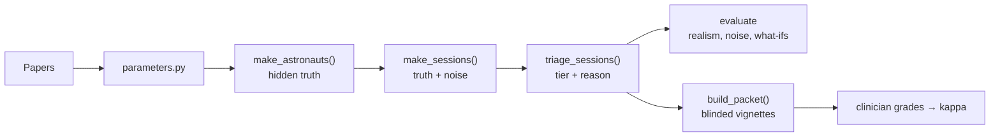
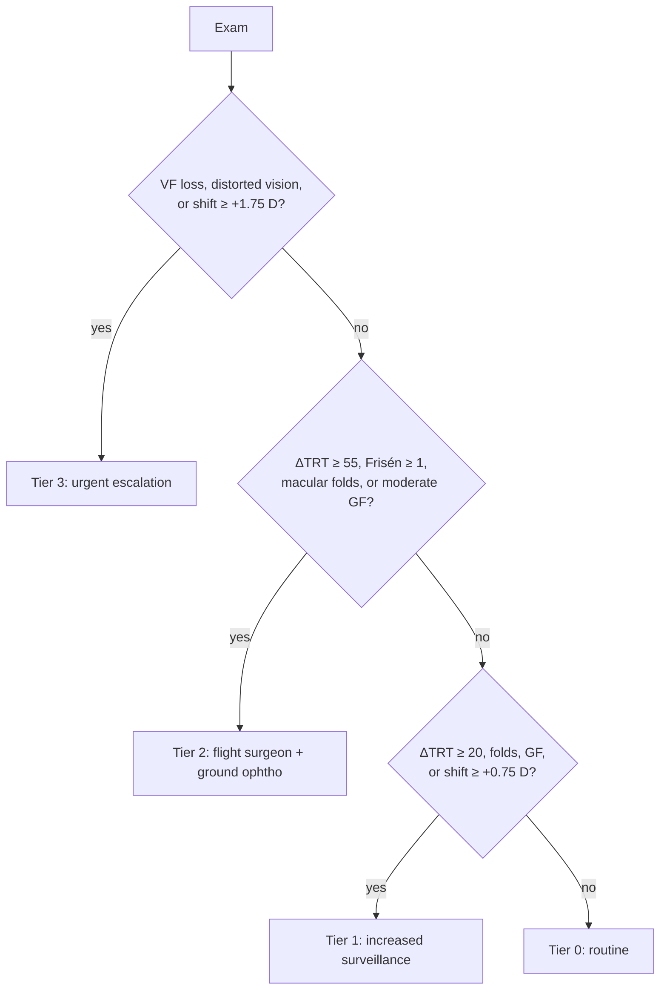

# Pipeline, tier logic, limitations

## Tier logic

Tiers from NASA (Brunstetter 2023; Gew 2026). Actions are drafts. +1.75 D is assumed.
FD30 flag (Carter 2026): ΔTRT > 29 µm → progression risk; < 20 µm → low risk. Never changes tier.

## Limitations
* Small source cohorts (n = 11–43); reproduces averages, not individuals.
* 23/55 parameters assumed (see `outputs/parameter_provenance.csv`).
* In-flight only, one eye, no MRI or history.
* Absolute thresholds only, no rate of change yet.
* Frisén grader disagreement not simulated.
* Late progression low vs Carter 2026; cup effect weaker than Pardon 2022.

## Reuse for another condition
Swap `parameters.py`, the sign model in `generator.py`, and the rules in `triage.py`. Evaluation and vignettes stay the same.

## Next (from Oct 23)
* Rate-of-change rules + orbital ultrasound follow-up (Dr. Dave)
* Clinician review of profiles, thresholds, actions
* Vignette grading → kappa
* Pre/post-flight timepoints; Earth-based data (Elizabeth)
